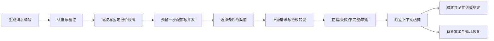

# Civic Relay 稳定性与智能体接入设计

日期：2026-10-03。项目根目录：`E:/生产项目/项目/TrailblazerStation/civic-ai-relay`。

状态：用户已确认六项补齐范围并要求写计划；本轮交付设计与实施计划，尚未授权执行代码修改或生产发布。用户已明确：**备用渠道切换时保持公开模型的固定报价**。

## 1. 目标与范围

完善可靠结算、长任务与流结束、Responses 协议、请求诊断、多渠道路由、备份及发布验证六项。保留 Go 单服务、SQLite、现有 Key/App-ID、模型名称、分组、配额窗口和计价单位。新数据库结构采用向前追加迁移。

本轮规划不增加账户中心、充值系统、多实例共享账本、Redis、工具执行沙箱、服务端聊天内容存储、WebSocket、异步后台生成。网关负责转发工具调用，工具仍由客户端或原生上游执行。

## 2. 方案比较

| 方案 | 收益 | 代价 | 选择 |
|---|---|---|---|
| A. 分阶段增强现有服务 | 既有数据和客户端直接延续，各阶段可单独验收发布 | 需要逐步补足生命周期与协议测试 | 采用 |
| B. 更换通用网关并迁移账本 | 可复用成熟路由、协议支持 | Key、授权、价格和历史数据需要迁移，现有定制功能要重新接入 | 不采用 |
| C. 重建分布式网关 | 可支持多实例和更高并发 | 扩大运维面，先解决当前规模没有要求的问题 | 不采用 |

## 3. 已验证问题

1. 旧版 340 秒总超时已在当前源码移除；当前等待响应头仍默认 310 秒。
2. `MAX_STREAM_DURATION=0` 被正数配置解析器拒绝，与“不限”说明矛盾。
3. 取消后用已取消 context 结算，账本仍为 reserved；并发为 1 的 Key 后续请求被拒绝。
4. 上游无 `[DONE]` 的干净 EOF 被记为 completed；Responses 仍发 response.completed。
5. Responses 的 tools、reasoning 在转换中丢失；非 message 输入与工具结果被忽略。
6. 上游 503 在账本记录为 upstream_status=200。
7. 缺定时 SSE 心跳、统一错误元数据、备用渠道选择和自动恢复验证。

证据保存在 `.codex/timeout-investigation/report-2026-10-03.md`、`.codex/maturity-audit/review-2026-10-03.md` 和对应隔离验证脚本。它们证明当前缺口，不是修复后验收结果。

## 4. 请求生命周期

- 一个客户端请求一个 request_id、一次 RPM/额度预留和一次最终结算；多渠道尝试只增加 attempt 元数据。
- 认证和参数错误在发送 SSE 响应前用 HTTP JSON 错误返回，不启动上游。
- 在准入成功后开始 SSE 注释心跳，允许模型长时间思考。此后上游错误通过该协议的失败事件返回，HTTP 200 只表示流已建立，不能当作生成成功。
- 任何正文、推理、工具调用或原生 response.created 等 JSON 业务事件一旦发给客户端，该请求不再切换渠道。响应头与 SSE 注释心跳不触发此限制。
- 默认不自动重试“已提交 POST 后的响应头等待超时”，因为无法确认上游是否已经执行。可切换的失败限定为 429/502/503/504 和可以证明未写出请求的建连失败。

## 5. 可靠结算

`store.Settlement` 保存一次终态所需的已知用量、金额、真实上游状态和稳定错误码。账本事务从 reserved 原子转为 completed/failed/aborted，重复提交同一个结果不累加金额；冲突终态返回明确错误，不覆盖第一次结果。

`Lease.Close` 使用 `context.WithoutCancel(parent)` 加 5 秒截止时间；最多三次尝试，只对 SQLite busy/locked 等瞬时错误重试。进程内全局/Key 闸门通过 sync.Once 释放，和数据库结算成功状态分别记录。失败不可静默：输出 request_id 和错误码，并将终态放入有界 reconciliation 队列。准入时先申请结算槽，active与pending共同占用全局并发上限容量，失败移交pending不另增槽，结算成功才归还；无空槽暂停新的公共请求，管理和健康端点仍可访问。调低配置不删除既有槽或队列项。恢复重试间隔 5 秒。

进程内记录 active reservation IDs，失败先原子移交pending再移除active。周期回收显式排除 active/pending IDs，历史Prune也排除reserved；无限时长流、配置调小后的既有流都不因回收阈值或retention被误结算/删除。单实例启动时、监听公共请求之前恢复崩溃留下的 reserved 行。失去真实 usage 的崩溃请求标 aborted/usage_source=unknown，释放预留，不虚构费用。

停机先拒绝新公共请求，再等待在途请求；超过现有 15 秒停机窗口后主动取消流并给结算留出窗口，然后关闭数据库。继续保留容器 30 秒 stop_grace_period，验收实际退出顺序。

## 6. 超时与 SSE

| 设置 | 规则 |
|---|---|
| `MAX_STREAM_DURATION` | 0/0s 表示不限，负数拒绝；默认 1800s，覆盖等待上游及读取响应体。修改用于新请求，既有请求保留其创建时的截止时间。 |
| `UPSTREAM_HEADER_TIMEOUT` | 新增可选参数。未配置时沿用 connect+read 的旧规则；首次生成新配置时为 1800s。旧配置升级不隐式改写。 |
| `SSE_HEARTBEAT_INTERVAL` | 新增，默认 15s；0 关闭。写 `: relay-heartbeat\n\n`，不产生 token、不算首个业务事件。 |
| `UPSTREAM_IDLE_TIMEOUT` | 新增，默认 0 关闭；正值限制相邻上游字节之间的静默时间。心跳发送不能重置这个上游时钟。 |

上游连接超时真正接入 net.Dialer 与 TLS 握手；不重新引入 http.Client.Timeout。旧 UPSTREAM_READ_TIMEOUT 保留作未配置新响应头设置时的兼容值；旧 WRITE/POOL 参数的实际含义在管理端与文档明确，禁止继续把它们称作流总超时。所有 Transport 参数变动须重启，心跳与请求总时长用于新请求。

SSE 读取以完整事件为单位（支持 CRLF、多行 data、注释、跨读取边界），单事件仍上限 1 MiB。只有单个发送循环写 ResponseWriter，避免心跳与 JSON 帧交错。每次Write/Flush设置有界写截止，结束后清除，避免长静默触发遗留deadline。读 goroutine 受 context/Body.Close 控制，取消后退出并回收。

Chat 正常结束要求 `[DONE]`；仅收到 finish_reason 不能直接忽略尾部 usage，必须继续读至 DONE。length 视作合法受限结束，在诊断记录 incomplete_reason=max_output_tokens；客户端仍收到上游原始 finish_reason。无 DONE 的 EOF/非法事件/读取错误标 failed。Responses 原生以 response.completed/response.failed/response.incomplete 为终态，不要求 Chat 的 DONE；桥接层按状态生成相应事件，禁止失败时发送 completed。

Nginx 配置示例包含 proxy_buffering off、proxy_cache off、足够长的 proxy_read_timeout，服务返回 X-Accel-Buffering: no。客户端另有绝对超时仍需由客户端配置；网关心跳不能延长上游响应头等待预算。

## 7. Responses 的两条路径

供应商新增 `responses_mode`：`bridge`（旧渠道默认）或 `native`（运维显式选择）。公共 chat 路由继续走 chat/completions。

| 能力 | bridge | native |
|---|---|---|
| 文本、instructions | 映射为 Chat 消息 | 原样转发 |
| function tools、tool_choice、parallel_tool_calls | 映射函数定义、调用和结果 | 原样转发 |
| reasoning.effort | 映射 reasoning_effort；其他不能保真字段显式 400 | 原样转发，输入输出 Items 不丢弃 |
| function_call / function_call_output | 按 call_id 建立 Chat assistant.tool_calls 和 tool 消息；引用不匹配拒绝 | 原样保留 |
| 推理内容/摘要事件 | 对支持的 reasoning_content 做明确的摘要事件映射，不伪造加密推理 Items | 原样转发 reasoning Items 与事件 |
| 图片、内建工具、加密推理 Items | 无映射支持的字段明确 400 unsupported_capability | 按已配置上游能力透传；本地不执行工具 |

为保持网关不存聊天内容和安全隔离，首版采用无状态完整上下文回传：默认并强制 store=false，禁止 previous_response_id、conversation、background。收到这些需要服务端状态的字段时明确 400，而不是丢弃。后续要做有状态 Responses 必须单独设计 Key/渠道/response-id 归属校验。

原生输入保留所有允许 Items，仅改模型名和网关必要选项；Usage 归一到 PromptTokens/CompletionTokens/CachedTokens，reasoning tokens 不重复加计。公开模型名称在返回和相关生命周期事件中改回，ID/call_id 不篡改。未知原生事件只读取最小元数据并原样转发，不把未知事件当作文本或工具结果。

工具参数增量分片按 item ID/index 拼接，函数调用输出是 function_call Item，不塞进 text。网关保留 tool_call_id / call_id，工具执行结果由下一次客户端 input 传回。功能上线前用虚构工具完成两轮闭环，并做流式/非流式各一次。

## 8. 诊断

新增请求追踪上下文和 X-Request-Id；默认由服务端生成，客户端 X-Request-Id 只作为通过长度/字符校验的关联字段，不能覆盖唯一账本 ID。访问日志包装器实现 Unwrap，以使 http.ResponseController 能透传 Flush 和写超时控制。

请求记录新增 error_code、failure_stage、duration_ms、upstream_header_ms、first_event_ms、last_upstream_ms、usage_source、attempt_count、protocol。缺失时间用 NULL，不用 0 冒充立即完成。错误日志不输出 prompt、回复、工具参数、请求头、查询串或供应商原始错误正文。

管理端支持按请求编号、状态、渠道、模型、协议、时间筛选和游标分页；保留旧 data 列表响应，并追加 next_cursor。请求详情展示 attempt 元数据、终态与估算计费标签。INFO 只记录异常结果，DEBUG 保留逐请求日志。

## 9. 多渠道与固定报价

新增 model_targets，既有模型迁移为一个默认 target。公开模型仍一份 input/output/cached 单价；每次准入冻结单价及该 Key 在可用授权分组上的最大倍率，所有后续尝试用同一报价。供应商成本差异不改变客户端费用。

候选必须满足公开模型启用且已定价、target 启用、供应商启用、Key 绑定的启用组包含该供应商、协议能力符合本次请求。公共模型目录和接入信息共用同一授权查询，不允许备用渠道绕过分组授权。

优先级整数越小越优先；同优先级按 target ID 排序。首版不加权随机。新路由默认 max_attempts=1，运维为已配置备用的模型打开时最多 2 次。不跨不同公开模型切换。

熔断采用内存状态：连续 3 次 eligible 瞬时故障 open 60s，之后仅一个 half-open 探测请求；成功关闭，失败重新 open。401/403/400、额度错误、客户端取消、输出后故障不自动重试。/models 探活只供展示，不自动修改熔断或启用状态。重启后熔断复位，不改变数据库配置。

请求只有一次预留和一次结算；attempt 单独记录上游目标、结果和耗时。发送任何 JSON 业务事件后禁止切换，即使客户端只看到了 response.created；注释心跳不影响切换许可。

## 10. 备份、恢复、发布

保留手动停机备份恢复；首先修正脚本失败后的运行状态恢复。增加在线备份：进程内 SQLite VACUUM INTO 到唯一临时目录，包含运行中实际使用的 relay.env（不使用尚未重启生效的密钥）、数据库快照、版本、迁移版本和 SHA-256 manifest。检查 quick_check、foreign_key_check 和密钥解密后原子发布归档；临时文件不进入保留策略。

在线备份 API 只允许管理员创建和查看备份元数据，不在普通管理响应中返回密钥或备份字节。备份卷为 /app/backups，UID65532可写；同时更新 Dockerfile、Compose、systemd 写目录和 Deploy 自有站点档案。配置变更与有效配置快照读取序列化，保证数据库对应有效加密密钥。首版禁止通过管理配置直接改RELAY_ENCRYPTION_KEY，非空新值与运行密钥不同时返回encryption_key_rotation_required；轮换需要单独的重加密事务，不能仅保存重启。备份使用有效DB路径并规范归档内DB_PATH=data/relay.db。

备份默认关闭；启用后按 Asia/Shanghai 每日 03:00 一次，自动成功备份保留最近 7 份；手动备份不被自动轮换。异地传输由显式配置的主机端接收目标执行，仅发送经过 age 公钥加密的归档；接收方私钥不保存在生产服务中。默认不配置远端、不自动上传。

恢复先校验归档入口、哈希、版本和密钥，在隔离目录跑数据库检查与解密，再备份当前状态，停止服务并替换数据与配置。识别符号链接、绝对路径及 .. 路径逃逸；恢复失败恢复旧数据和旧运行状态。跨迁移回滚用旧镜像+对应旧数据库备份，不能只改镜像标签。

Linux CI 运行 Go test/vet/race、协议集成、SQLite迁移和恢复检查、Python导出测试、镜像构建与健康检查。发布离线包、源码ZIP和插件ZIP都带版本和 SHA-256 校验。生产灰度为后续明确发布动作，计划不会自动访问远程服务器。

## 11. 数据迁移与发布顺序

当前迁移最高 v12。执行前再次检查最新编号，顺序追加，不复用已存在编号：

1. v13：结算与诊断元数据、请求价格快照所需字段。
2. v14：供应商 responses_mode。
3. v15：model_targets、request_attempts、候选优先级及模型 max_attempts。

先实施阶段 1 → 2 → 4，建议发布 v0.3.8；再阶段 3，建议发布 v0.3.9；最后阶段 5 → 6，建议发布 v0.4.0。版本是计划目标，执行前按真实最近发布调整；本轮不修改版本、提交或部署。

阶段6的手动备份/恢复安全修正应在首次迁移发布前完成；在线备份与调度可在1/2/4完成后提前实施，最终全功能发布门禁再等协议和路由。备份能力的实施不必被完整阶段编号顺序阻塞。

## 12. 总验收

- 并发为1的Key取消后立即可再次使用；同一请求不会重复计费。
- 无DONE/终态的坏流不显示成功；真实错误状态和请求编号能在管理端找到。
- 新配置0=不限可保存、重启恢复；无限流和热调小配置不会被回收误杀。
- 等待上游期间也有心跳；断开、超时、停机不泄漏goroutine或数据库预留。
- bridge/native均完成函数调用→函数结果→最终文本闭环；不支持的能力明确拒绝。
- 备用切换只走授权渠道，报价冻结，不重播已发出的业务事件。
- 在线备份期间请求可服务，隔离恢复成功，错误备份不覆盖当前数据。
- 新旧配置、v12数据库、已有客户端Key和App-ID、导出插件合同通过升级回归。

## 13. 外部协议依据

- [OpenAI 流式事件](https://developers.openai.com/api/docs/guides/streaming-responses)：完成和失败有独立事件。
- [Responses 迁移](https://developers.openai.com/api/docs/guides/migrate-to-responses)：函数调用、结果和推理分别属于 Items；工具结果按 call_id 对应。
- [SQLite VACUUM INTO](https://www.sqlite.org/lang_vacuum.html)：用于运行中数据库的一致快照；中断产物仍需校验，不能直接认定完成。
- [Nginx 代理参数](https://nginx.org/en/docs/http/ngx_http_proxy_module.html#proxy_read_timeout)：读超时按连续无上游数据间隔计算。
